# Base de datos — modelo, conexión y migraciones

Una sola base de **PostgreSQL en Supabase** para todo el equipo. El esquema vive en
`backend/sql/` como scripts numerados y se aplica con `pnpm db:migrar`.

De Supabase solo se usa la base: el backend se conecta directo a PostgreSQL con `pg`.
No se usan su API, su cliente (`supabase-js`) ni su autenticación.

## Conectarse a la base compartida

En `backend/.env` (hay una plantilla en `backend/.env.example`):

```
DATA_MODE=sql
DB_SERVER=aws-0-<región>.pooler.supabase.com
DB_NAME=postgres
DB_USER=postgres.<referencia-del-proyecto>
DB_PASSWORD=<contraseña>
DB_CA_CERT=certs/supabase-ca.crt
```

- Los valores salen del botón **Connect** del proyecto en Supabase, opción **Session
  pooler** (*View parameters*). La conexión directa (`db.<referencia>.supabase.co`) solo
  funciona con IPv6, así que no sirve en la mayoría de las redes.
- `DB_PORT` es `5432` por omisión, el del Session pooler.
- La conexión siempre va cifrada. El certificado del servidor lo firma la autoridad de
  Supabase, que Node no conoce: `DB_CA_CERT` apunta al archivo que se descarga en
  **Database → Settings → SSL Configuration → Download certificate**, guardado como
  `backend/certs/supabase-ca.crt`. Es un certificado público y puede ir en git.
- `DB_TRUST_CERT=true` cifra sin validar el certificado. Es para un PostgreSQL local con
  certificado autofirmado y no arranca en producción.
- El backend arma la conexión con esas variables en `RepositorioSql.conectar`
  (`backend/src/repos/sql.ts`) y todas las rutas comparten ese mismo pool.
- La contraseña se comparte por un canal privado. Los `.env` no se suben a git.
- En el plan gratuito, Supabase pausa el proyecto tras una semana sin actividad; se
  reactiva desde su panel.
- En el `.env` de la raíz, `VITE_USE_REAL_BACKEND=true` para que la vista de hallazgos
  use la base en lugar de sus datos de prueba.

Para trabajar sin la base compartida sigue sirviendo `DATA_MODE=memoria`.

## Migraciones

```bash
cd backend
corepack pnpm db:migrar                  # aplica los scripts que falten
corepack pnpm db:migrar --datos-prueba   # además, hallazgos y controles de prueba
corepack pnpm db:migrar --admin-nombre "Nombre Apellido" --admin-correo correo@dominio.com
```

El comando usa las variables `DB_*` del `.env`, así que corre contra la base a la que
apunta el backend. Anota cada script aplicado en la tabla `schema_migrations` (nombre,
huella del contenido y fecha) y la siguiente vez solo corre los que faltan.

| Script | Contenido |
|---|---|
| `001_schema.sql` | `roles`, `permissions`, `role_permissions`, `users`, `audit_plans`, `evidence` |
| `002_seed.sql` | Roles y permisos iniciales; dos evidencias de prueba |
| `003_primer_administrador.sql` | Primer Administrador. Lo sustituye `--admin-nombre` y `--admin-correo` |
| `004_findings.sql` | `findings` |
| `005_seed_findings.sql` | Hallazgos de prueba. Solo con `--datos-prueba` |
| `006_auditorias.sql` | `audits` y cuatro auditorías de prueba |
| `007_action_plans.sql` | `action_plans` |
| `008_estructura_y_controles.sql` | `fiscal_periods`, `business_units`, `processes`, `controls`, `audit_controls`, `conflict_declarations` |
| `009_seed_controles.sql` | Controles de prueba. Solo con `--datos-prueba` |
| `010_catalogos_riesgos_y_ejecucion.sql` | Catálogos (`catalogs`, `catalog_department`, `catalog_domain`, `audit_status`, `audit_procedure_type`), estructura (`division`, `business`, `area`, `audit_entity`), riesgos (`risk_library`, `control_procedure`, `risk_register`) y ejecución (`audit_engagement`, `audit_engagement_team`, `audit_procedures`); agrega `business_units.catalog_id` |
| `011_seed_demo.sql` | Usuarios de "Usar un rol de prueba", planes de auditoría, hallazgos y plan de acción del modo en memoria. Solo con `--datos-prueba` |

### Cómo agregar un cambio al esquema

1. Crear un script nuevo con el siguiente número (`010_...sql`). **No editar uno que ya
   se aplicó a la base compartida**: quien ya lo corrió no recibiría el cambio.
2. Escribirlo de modo que se pueda repetir (`CREATE TABLE IF NOT EXISTS`,
   `ON CONFLICT DO NOTHING`) y activar la seguridad por filas en cada tabla nueva
   (`ALTER TABLE ... ENABLE ROW LEVEL SECURITY`).
3. Agregarlo a la lista `SCRIPTS` de `backend/src/migrar.ts` (o a `SCRIPTS_DATOS_PRUEBA`
   si son datos de prueba).
4. Probarlo en una base local y luego correr `pnpm db:migrar` contra la compartida.
5. Actualizar el diagrama de abajo y el de Miro.

Cada script corre dentro de una transacción: si falla, no se aplica nada de él.

### Particularidades de PostgreSQL

- **Seguridad por filas.** Supabase publica por su API las tablas del esquema `public`.
  Todas llevan la seguridad por filas activada y ninguna política, así que por esa API
  no se lee ni se escribe nada; el backend entra con el usuario dueño de las tablas.
- **Mayúsculas.** PostgreSQL distingue mayúsculas al comparar texto. Las columnas que
  deben ser únicas sin distinguirlas (`users.email`, `roles.name`, `permissions.name`,
  `audit_plans.code`, `findings.folio`, `fiscal_periods.name`, `business_units.name`,
  `processes.name`, `controls.code`) usan la intercalación `sin_mayusculas`, definida en
  `001_schema.sql`. Esas columnas no admiten `LIKE`.
- **Columnas en camelCase.** `findings` conserva `auditId`, `controlId`, `failedControl`,
  `residualRisk` y `ownerId`; en cada consulta van entre comillas dobles (`f."auditId"`).
- **Fechas.** Las columnas `DATE` se piden como texto (`p.start_date::text`) para que
  lleguen como `AAAA-MM-DD`; los `TIMESTAMPTZ` llegan como `Date`.
- **Parámetros.** Las consultas usan `$1`, `$2`… y `RETURNING` para devolver la fila
  insertada o modificada.

### Probar contra un PostgreSQL local

Las pruebas de `test/sql.integracion.test.ts` (repositorios) y de
`test/esquema.integracion.test.ts` (los scripts completos: las 30 tablas existen, tienen
la seguridad por filas activada, se pueden consultar y hacen cumplir sus llaves) se
omiten si no hay conexión. Para
correrlas hace falta un PostgreSQL con TLS y una base exclusiva de pruebas:

```bash
docker run -d --name expedite-pg -e POSTGRES_PASSWORD=<contraseña> -e POSTGRES_DB=expedite_test \
  -p 5432:5432 postgres:17 -c ssl=on \
  -c ssl_cert_file=/etc/ssl/certs/ssl-cert-snakeoil.pem -c ssl_key_file=/etc/ssl/private/ssl-cert-snakeoil.key

SQL_TEST_SERVER=localhost SQL_TEST_DATABASE=expedite_test SQL_TEST_USER=postgres \
  SQL_TEST_PASSWORD=<contraseña> SQL_TEST_TRUST_CERT=true corepack pnpm test
```

## Modelo entidad-relación

Las líneas punteadas son referencias que la base todavía no valida con llave foránea.

```mermaid
erDiagram
    roles ||--o{ users : "role_id"
    roles ||--o{ role_permissions : "role_id"
    permissions ||--o{ role_permissions : "permission_id"
    users ||--o{ audit_plans : "responsible_id, created_by"
    fiscal_periods ||--o{ business_units : "fiscal_period_id"
    users ||--o{ business_units : "manager_id, created_by"
    business_units ||--o{ processes : "business_unit_id"
    processes ||--o{ controls : "process_id"
    users ||--o{ controls : "owner_id"
    audits ||--o{ audit_controls : "audit_id"
    controls ||--o{ audit_controls : "control_id"
    users ||--o{ audit_controls : "auditor_id, assigned_by"
    audits ||--o{ conflict_declarations : "audit_id"
    users ||--o{ conflict_declarations : "auditor_id"
    findings ||--o| action_plans : "finding_id"
    users ||--o{ action_plans : "responsible_id, created_by"
    audits ||..o{ findings : "auditId"
    controls ||..o{ findings : "controlId"
    users ||..o{ findings : "ownerId"
    audits ||..o{ evidence : "audit_id"
    controls ||..o{ evidence : "control_id"
    findings ||..o{ evidence : "finding_id"
    catalogs ||--o{ division : "catalog_id"
    catalogs ||--o{ business : "catalog_id"
    catalogs ||--o{ area : "catalog_id"
    catalogs ||--o{ business_units : "catalog_id"
    catalogs ||--o{ control_procedure : "catalog_id"
    catalogs ||--o{ risk_register : "catalog_id"
    risk_library ||--o{ risk_register : "risk_library_id"
    control_procedure ||--o{ risk_register : "control_procedure_id"
    catalog_department ||--o{ audit_entity : "department_id"
    catalog_domain ||--o{ audit_entity : "domain_id"
    audit_plans ||--o{ audit_engagement : "audit_plan_id"
    audit_entity ||--o{ audit_engagement : "audit_entity_id"
    catalog_department ||--o{ audit_engagement : "department_id"
    catalog_domain ||--o{ audit_engagement : "domain_id"
    users ||--o{ audit_engagement : "lead_auditor_id"
    audit_status ||--o{ audit_engagement : "status_id"
    audit_engagement ||--o{ audit_engagement_team : "audit_engagement_id"
    users ||--o{ audit_engagement_team : "auditor_id"
    audit_engagement ||--o{ audit_procedures : "audit_engagement_id"
    audit_procedure_type ||--o{ audit_procedures : "procedure_type_id"
    catalog_department ||--o{ audit_procedures : "department_id"
    catalog_domain ||--o{ audit_procedures : "domain_id"
    users ||--o{ audit_procedures : "assigned_to"
    audit_status ||--o{ audit_procedures : "status_id"

    roles {
        int id PK
        string name UK
    }
    permissions {
        int id PK
        string name UK
    }
    role_permissions {
        int role_id PK, FK
        int permission_id PK, FK
    }
    users {
        int id PK
        string name
        string email UK
        int role_id FK
        string status
        string entra_oid UK
        datetime last_login
        datetime created_at
    }
    audit_plans {
        int id PK
        string code UK
        string name
        string type
        string period
        date start_date
        date end_date
        string status
        int estimated_hours
        int responsible_id FK
        string scope
        int created_by FK
        datetime created_at
    }
    fiscal_periods {
        int id PK
        string name UK
        date start_date
        date end_date
        boolean is_active
        datetime created_at
    }
    business_units {
        int id PK
        string name UK
        int manager_id FK
        int fiscal_period_id FK
        int created_by FK
        datetime created_at
        int catalog_id FK
    }
    processes {
        int id PK
        int business_unit_id FK
        string name
        datetime created_at
    }
    controls {
        string id PK
        string code UK
        string name
        string description
        string type
        string frequency
        int process_id FK
        int owner_id FK
        datetime created_at
    }
    audits {
        string id PK
        string name
        date end_date
        datetime created_at
    }
    audit_controls {
        int id PK
        string audit_id FK
        string control_id FK
        int auditor_id FK
        boolean is_lead
        int assigned_by FK
        datetime created_at
    }
    conflict_declarations {
        int id PK
        string audit_id FK
        int auditor_id FK
        boolean has_conflict
        string justification
        datetime declared_at
    }
    findings {
        string id PK
        string folio UK
        string title
        string description
        string type
        string severity
        string status
        string auditId
        string controlId
        string failedControl
        string residualRisk
        string ownerId
        datetime created_at
    }
    action_plans {
        int id PK
        string finding_id FK, UK
        string description
        int responsible_id FK
        date due_date
        string status
        int created_by FK
        datetime created_at
    }
    evidence {
        string id PK
        string entity_id
        string entity_type
        string file_name
        string mime_type
        bigint file_size
        string file_hash
        string storage_path
        string uploaded_by
        datetime created_at
        string control_id
        string finding_id
        string audit_id
    }
    catalogs {
        int catalog_id PK
        string business
        string country
    }
    catalog_department {
        int id PK
        string name
    }
    catalog_domain {
        int id PK
        string name
    }
    division {
        int division_id PK
        string name
        int catalog_id FK
    }
    business {
        int business_id PK
        string business_name
        int catalog_id FK
    }
    area {
        int area_id PK
        string area_name
        int catalog_id FK
    }
    audit_entity {
        int id PK
        string name
        int department_id FK
        int domain_id FK
    }
    risk_library {
        int risk_library_id PK
        string name
    }
    control_procedure {
        int control_procedure_id PK
        string description
        int catalog_id FK
    }
    risk_register {
        int risk_register_id PK
        int catalog_id FK
        int risk_library_id FK
        int control_procedure_id FK
    }
    audit_status {
        int id PK
        string name
    }
    audit_procedure_type {
        int id PK
        string name
    }
    audit_engagement {
        int id PK
        string code
        int audit_plan_id FK
        int audit_entity_id FK
        int department_id FK
        int domain_id FK
        int lead_auditor_id FK
        int status_id FK
    }
    audit_engagement_team {
        int id PK
        int audit_engagement_id FK
        int auditor_id FK
        string role_in_engagement
    }
    audit_procedures {
        int id PK
        string code
        int audit_engagement_id FK
        int procedure_type_id FK
        int department_id FK
        int domain_id FK
        int assigned_to FK
        int status_id FK
    }
```



## Reglas que hace cumplir la base

| Tabla | Regla |
|---|---|
| `fiscal_periods` | Nombre único; la fecha de fin es posterior a la de inicio; un solo periodo activo a la vez |
| `business_units` | Nombre único; gerente responsable y periodo fiscal obligatorios |
| `processes` | El nombre no se repite dentro de la misma unidad de negocio |
| `controls` | Código único. El `id` es texto (`CTR-001`), igual que en `findings.controlId` y `evidence.control_id` |
| `audit_controls` | Un auditor se asigna una sola vez al mismo control en una auditoría; un control tiene a lo más un auditor líder por auditoría |
| `conflict_declarations` | Una declaración por auditor y auditoría; si hay conflicto, la justificación es obligatoria |
| `action_plans` | Un plan por hallazgo |

## Pendiente

- `findings` y `evidence` guardan sus referencias (`auditId`, `controlId`, `ownerId`,
  `control_id`, `finding_id`, `audit_id`) como texto sin llave foránea.
- `audits` solo tiene `id`, `name` y `end_date`; falta ligarla a `audit_plans` y a la
  unidad de negocio (SF-05).
- Las horas invertidas por control (historia de asignación de controles) no tienen tabla.
- Las tablas de `010_catalogos_riesgos_y_ejecucion.sql` solo tienen las columnas del
  diagrama de Miro y ninguna ruta del backend las usa todavía. Faltan sus reglas de
  negocio (nombres únicos, qué llaves son obligatorias) y definir cómo conviven `audits`
  con `audit_engagement`, y `business_units` con `business`, `division` y `area`.
